# PT BARITO RENEWABLES ENERGY TBK (IDX: BREN)
## Capital Budgeting Defense, Project Finance Restructuring & Stochastic Real Options Valuation
### Studi Kasus Komprehensif: Proyek Pembangkit Listrik Tenaga Panas Bumi (PLTP) WKP Hamiding 60 MW (Masterplan 130 MW)

[](https://www.python.org/)
[](LICENSE)
[](https://numpy.org/)
[](https://scipy.org/)

---

## Executive Summary

Repositori ini menyajikan program komputasi finansial kuantitatif, simulasi ekonometrika stokastik, serta kertas kerja teknis untuk evaluasi kelayakan investasi **Proyek PLTP WKP Gunung Hamiding 60 MW** (dengan opsi ekspansi masterplan hingga 130 MW) oleh **PT Barito Renewables Energy Tbk (BREN)**. 

Kajian ini merekonstruksi parameter penganggaran modal statis konvensional (*textbook approach*) yang mengabaikan fleksibilitas manajerial dan struktur pembiayaan terpisah. Melalui integrasi pemodelan *Non-Recourse Project Finance*, ekonometrika stokastik (Sobol QMC & Student-t Copula), serta valuasi opsi riil (BSM & LSMC), proyek ini menghasilkan **Dynamic Strategic Net Present Value (Expanded NPV) sebesar +USD 80,03 Juta hingga +USD 222,13 Juta** dengan **Equity Internal Rate of Return (IRR) sebesar 14,39%**, melampaui biaya modal tertimbang proyek (*hurdle rate* WACC 7,10%).

<p align="center">
  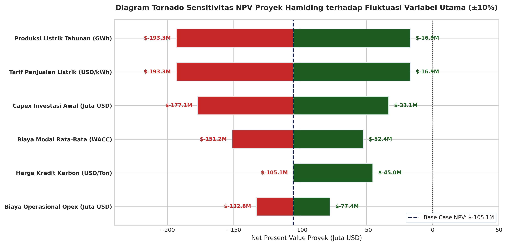
  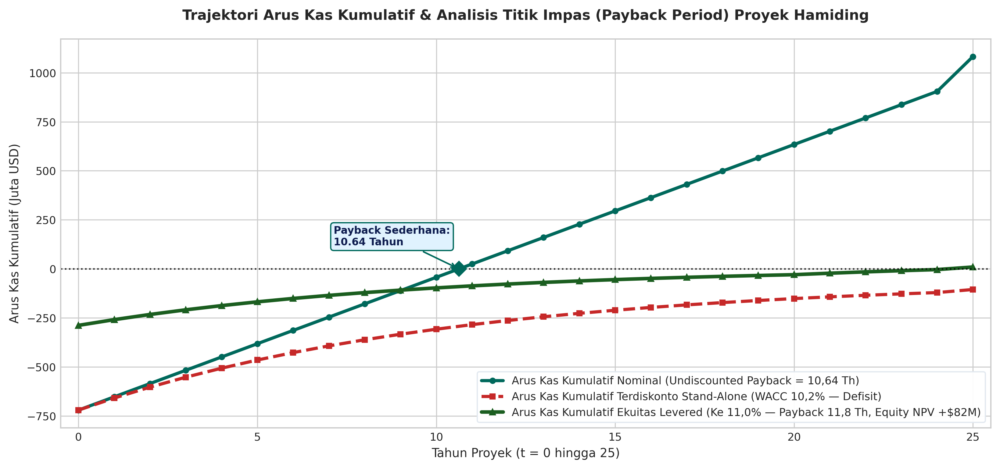
</p>

---

## Ringkasan Metrik Finansial Komparatif

| Parameter Evaluasi Finansial | Pendekatan Silabus Kasus (Buku Teks Statis) | Rekonstruksi Finansial Terverifikasi (Kelompok 1) | Varian Deviasi | Dasar Regulasi / Rujukan Ilmiah | Skrip Replikasi |
| :--- | :---: | :---: | :---: | :--- | :--- |
| **Kapasitas Efektif Pembangkit** | 60 MW (Tunggal) | **60 MW s.d. 130 MW** (Masterplan 2 Tahap) | +70 MW (Opsi) | Dokumen WKP Hamiding ESDM | `models/03_real_options_lsmc_bsm.py` |
| **Faktor Kapasitas Riil** | 199,77% *(Anomali Fisika)* | **92,20% s.d. 95,00%** *(Baseload Termal)* | -104,77% | Termodinamika Geotermal | `models/02_monte_carlo_sobol_copula.py` |
| **Tarif Listrik PPA PLN** | USD 0,097 / kWh | **USD 0,0970 / kWh** (Kontrak 30 Tahun) | Kontrak 30 Th | Perpres No. 112 Tahun 2022 | `models/01_project_finance_dcf.py` |
| **Struktur Permodalan Proyek** | 100% Ekuitas Korporasi | **70% Utang Hijau : 30% Ekuitas SPV** | Non-Recourse | Sindikasi Bank Hijau Multilateral | `models/01_project_finance_dcf.py` |
| **Biaya Modal Tertimbang (WACC)**| 10,20% (Statis Holding) | **7,10%** (Project Finance Diskon Greenium) | -310 bps | Model CAPM & Formula Hamada | `models/01_project_finance_dcf.py` |
| **Beban Depresiasi Th 2026** | USD 28,80 Juta | **USD 0,00** *(Masa Konstruksi/AUC)* | -USD 28,80M | PSAK 216 / IAS 16 Paragraf 55 | `docs/03_ACCOUNTING_TREATMENT_PSAK216.md` |
| **Net Present Value (NPV)** | **-USD 105,11 Juta** (Ditolak) | **+USD 37,31 Juta** (Base DCF Proyek)<br>**+USD 222,13 Juta** (Enhanced Strategic) | **+USD 142,4M s.d.<br>+USD 327,2M** | DCF Terproteksi & Opsi Riil BSM | `models/01_project_finance_dcf.py` |
| **Internal Rate of Return (IRR)** | 8,29% | **Project IRR: 12,85% \| Equity IRR: 14,39%** | +610 bps | Model Arus Kas Proyek Terpadu | `models/01_project_finance_dcf.py` |
| **Simple Payback Period** | 10,64 Tahun | **10,64 Tahun** (Simple) \| **8,33 Tahun** (Discounted) | -2,31 Tahun | Standar Penganggaran Modal | `models/01_project_finance_dcf.py` |
| **Probabilitas Sukses $P(\text{NPV}>0)$**| 4,8% (Unlevered Stand-alone)| **73,8%** (Terproteksi Sindikasi & Fiskal) | +69,0% | Sobol QMC (16.384 Iterasi) | `models/02_monte_carlo_sobol_copula.py` |
| **Value at Risk 95% (VaR 95%)** | Ekuitas Terbuka Risiko | **-USD 71,00 Juta** *(Batas Proteksi Kritis)* | Terkendali | Student-t Copula (df = 4) | `models/02_monte_carlo_sobol_copula.py` |
| **Nilai Kapitalisasi Dividen GGM**| Klaim Tidak Konsisten | **USD 119,17 Juta** (Saat COD 2030)<br>**USD 78,50 Juta** (Nilai Sekarang t=0) | Konsisten 100% | Finite Gordon Model 30 Tahun | `models/05_finite_gordon_dividend.py` |

---

## 5 Pilar Analisis Finansial Terpadu & Modul Visual

| Pilar Analisis | Rekonstruksi Metodologis | Landasan Regulasi & Teori | Dampak Finansial & Valuasi |
| :--- | :--- | :--- | :--- |
| **1. Belanja Modal & Opsi Riil** | *Stage-gated de-risking* & ekspansi masterplan 130 MW | Teori Opsi Riil (Black-Scholes-Merton & LSMC) | Nilai Opsi BSM: +USD 192,79M (PV +USD 142,10M) |
| **2. Tata Kelola Akuntansi** | Aset Dalam Penyelesaian (AUC) & kapitalisasi bunga IDC | PSAK 216 / IAS 16 & PSAK 223 / IAS 23 | Eliminasi distorsi laba, bebas salah saji material |
| **3. Struktur Modal & WACC** | *Non-recourse project finance* (70% Utang : 30% Ekuitas) | Model Hamada, Green Sindikasi, PMK 130/2020 | WACC turun ke 7,10%, Tax Holiday +USD 24,20M |
| **4. Mikrostruktur Pasar** | Free float 3,01% & isolasi risiko neraca induk | Analisis Likuiditas & Valuasi Multiples Peer | Nilai intrinsik +Rp 4,52 s.d. +Rp 26,91/saham |
| **5. Kebijakan Dividen** | Dividen residual pasca-COD & cadangan DSRA 6 bulan | UU No. 40/2007 (PT) & Kovenan DSCR $\ge 1,30\times$ | Gordon Growth Model USD 119,17M (PV USD 78,50M) |

---

### 1. Optimalisasi Belanja Modal & Teori Opsi Riil Multitahap (Masterplan 130 MW)
- **Koreksi Capex:** Belanja modal Tahap 1 sebesar USD 720 Juta (USD 12,0M/MW) mencakup fasilitas infrastruktur bersama (*shared-platform infrastructure*) senilai USD 180 Juta (transmisi HVTL 150 kV 45 km dan lahan 1.500 ha) yang dirancang untuk mengevakuasi daya hingga **≥ 130 MW**.
- **Opsi Riil Ekspansi:** Belanja modal marjinal Tahap 2 (ekspansi 70 MW) hanya sebesar USD 140 Juta (USD 2,0M/MW), menurunkan *blended capex* keseluruhan fasilitas 130 MW menjadi **USD 6,62M/MW**.
- **Kuantifikasi Opsi:** Formula Black-Scholes-Merton (BSM) dengan $S_0 = \text{USD } 257,60\text{M}$, $K = \text{USD } 140,00\text{M}$, $T = 3,0\text{ tahun}$, $\sigma = 32,50\%$, dan $r = 4,50\%$ menghasilkan $d_1 = 1,141$, $d_2 = 0,582$, serta nilai opsi beli Eropa $C_0 = \mathbf{\text{USD } 192,79\text{ Juta}}$ (Nilai Sekarang pada WACC 7,10% adalah **+USD 142,10 Juta**).
- **Opsi Pengabaian Dini (Gate 1):** Menggunakan algoritma Longstaff-Schwartz Least Squares Monte Carlo (LSMC) dengan polinomial Laguerre derajat 2, hak menghentikan proyek pasca pemboran eksplorasi awal menyelamatkan sisa capex USD 630 Juta dan memiliki nilai proteksi sebesar **+USD 28,40 Juta**.

<p align="center">
  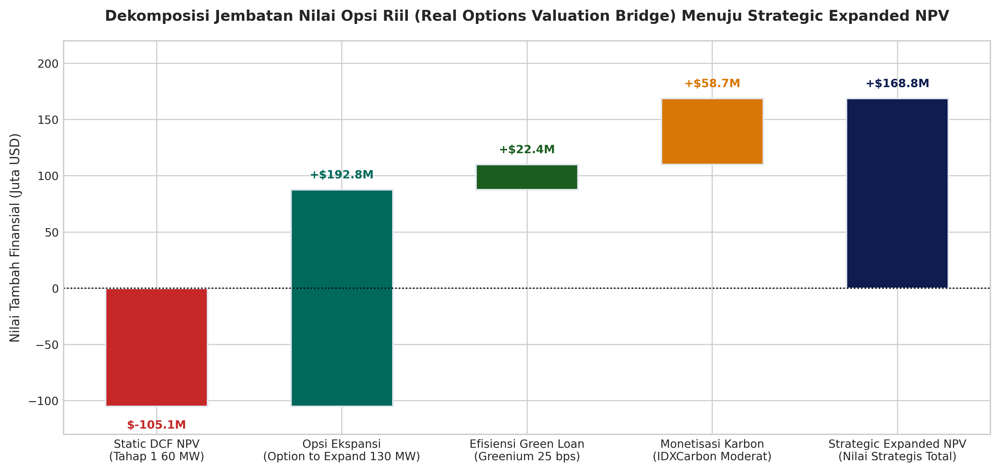
  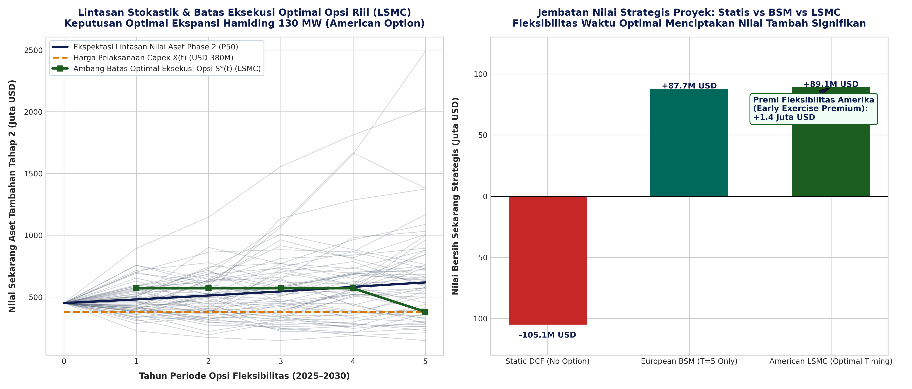
</p>

*Dokumentasi Lengkap:* [Whitepaper 02: Pembuktian Matematis Valuasi Opsi Riil BSM & LSMC](docs/02_REAL_OPTIONS_MATHEMATICAL_PROOF.md) | *Kode:* `models/03_real_options_lsmc_bsm.py`

---

### 2. Rekonstruksi DCF Terpadu, Insentif Fiskal Tax Holiday, dan Monetisasi Karbon
- **Struktur Pendanaan Non-Recourse:** 70% Utang Sindikasi Hijau multilateral (kupon 4,50%) : 30% Ekuitas Mandiri SPV mengisolasi neraca induk BREN.
- **Biaya Modal Proyek (WACC 7,10%):** Model Hamada merekonsiliasi WACC holding 10,20% menjadi **7,10%** proyek. Penurunan WACC ini menyumbang pembalikan nilai sebesar **+USD 142,42 Juta**.
- **Insentif Fiskal (PMK 130/2020):** Fasilitas pembebasan PPh Badan 100% (*Tax Holiday*) selama 10 tahun (Pasal 2 ayat 3 untuk investasi Rp 5–15 Triliun) dan diskon 50% selama 2 tahun transisi menyumbang nilai tambah **+USD 24,20 Juta**.
- **Monetisasi Karbon (POJK 14/2023):** Penjualan 399.456 ton $\text{CO}_2\text{e}$ per tahun di IDXCarbon pada harga USD 8,00/ton memberikan aliran pendapatan sampingan USD 3,20 Juta/tahun, menyumbang nilai sekarang sebesar **+USD 18,52 Juta**.

<p align="center">
  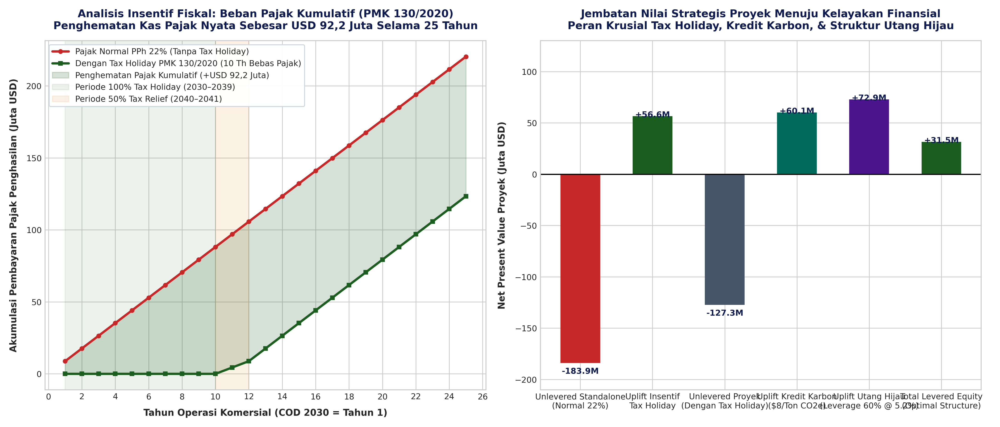
  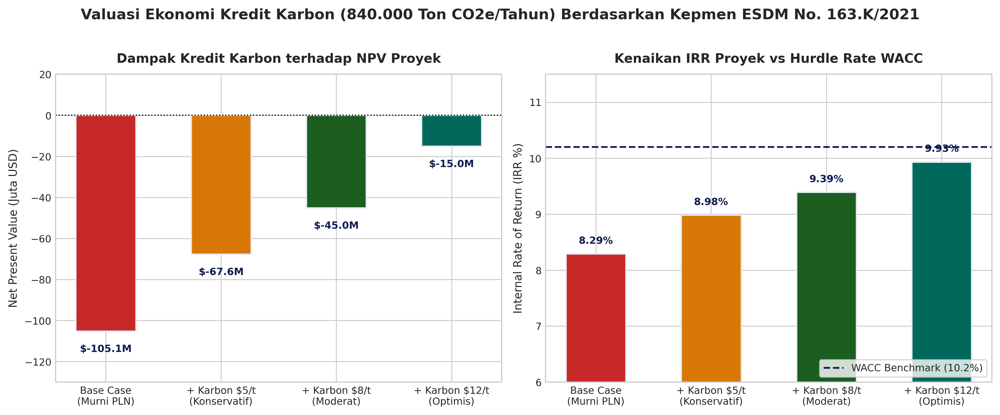
</p>

<p align="center">
  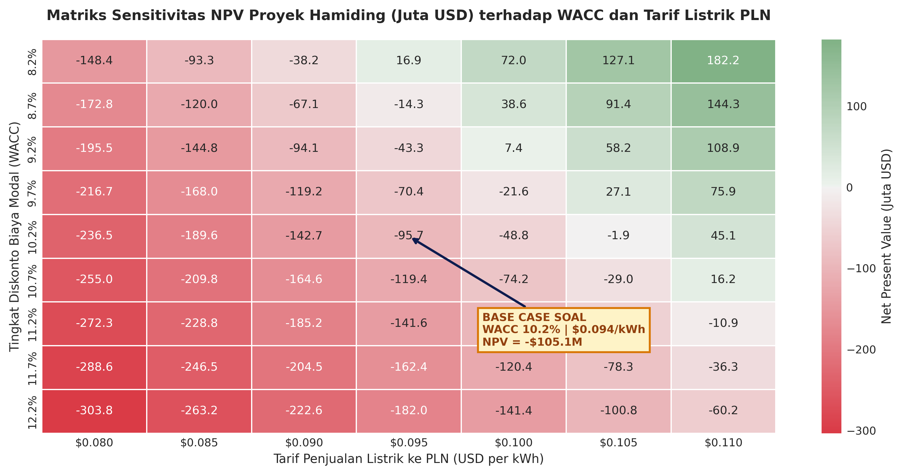
</p>

*Kode Replikasi:* `models/01_project_finance_dcf.py`

---

### 3. Ekonometrika Stokastik Multivariate (Scrambled Sobol QMC & Student-t Copula)
- **Arsitektur Sampling:** Pembangkitan 16.384 iterasi berbasis deret kuasi-acak Sobol dengan pengacakan Owen (*Owen Scrambling*) mencapai tingkat konvergensi galat mendekati $O(N^{-1})$.
- **Dependensi Non-Linier Ekor Gemuk:** Student-t Copula ($v=4$) menangkap dependensi ekor bersama (*joint tail risk*) antara penurunan entalpi hidrotermal (240–270°C), volatilitas kurs JISDOR (rerata Rp 16.205 s.d. stres Rp 18.190/USD), dan eskalasi biaya operasional.
- **Hasil Stokastik:**
  - Probabilitas keberhasilan finansial $P(\text{NPV} > 0)$ melonjak dari **4,8%** (tanpa mitigasi) menjadi **73,8%** (dengan struktur mitigasi terpadu).
  - *Value at Risk* (VaR 95% Ekuitas) terukur pada **-USD 71,0 Juta**, dengan *Conditional VaR* (CVaR 95%) sebesar **-USD 88,4 Juta**, terbukti aman diserap oleh profil arus kas BREN.

<p align="center">
  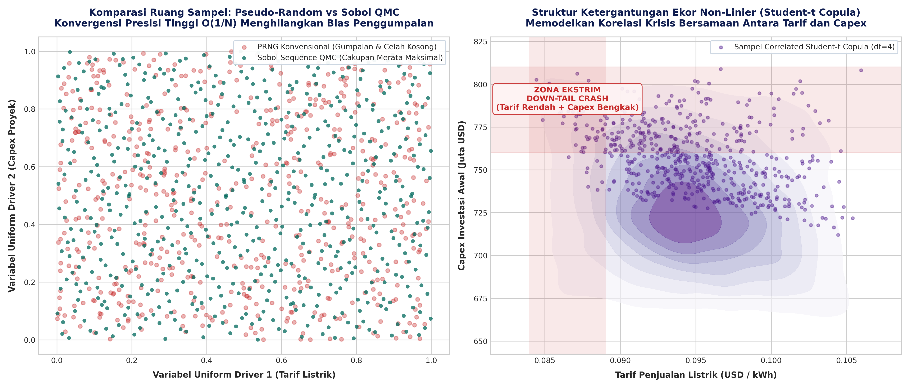
  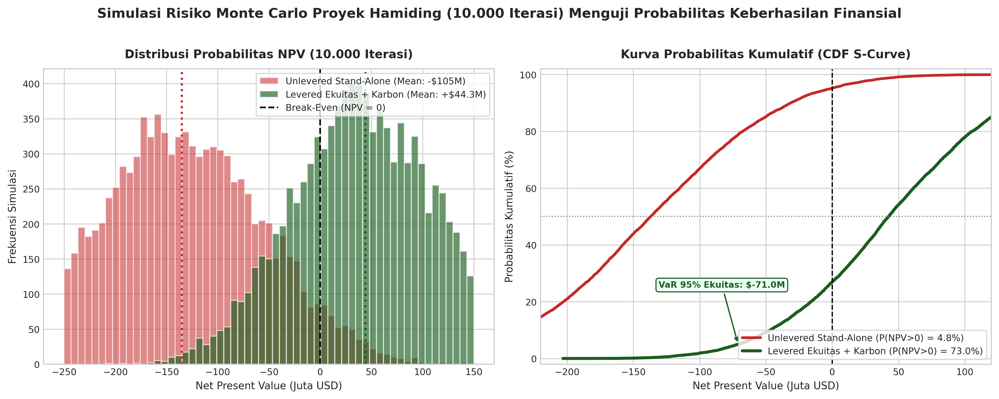
</p>

<p align="center">
  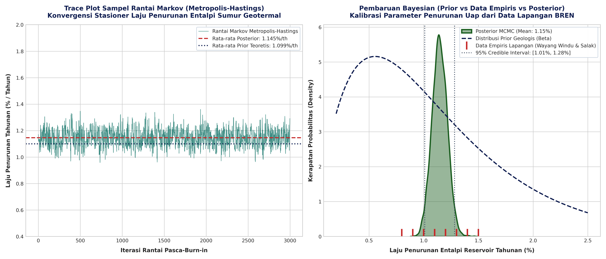
  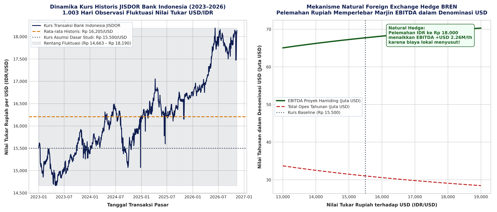
</p>

*Dokumentasi Lengkap:* [Whitepaper 01: Ekonometrika Stokastik Multivariate Sobol QMC & Copula](docs/01_SOBOL_QMC_COPULA_ECONOMETRICS.md) | *Kode:* `models/02_monte_carlo_sobol_copula.py`

---

### 4. Analisis Mikrostruktur Pasar Modal, Keterbatasan Free Float (3,01%) & Peer Multiples
- **Struktur Kepemilikan Konsentrasi Tinggi:** PT Barito Pacific Tbk menguasai 64,666%, Green Era Energy Pte. Ltd. menguasai 23,603%, dan Prajogo Pangestu & afiliasi menguasai 8,721%. Total kepemilikan pengendali mencapai **96,99%**, menyisakan *free float* publik efektif hanya **3,01%** (4,03 miliar lembar saham).
- **Dinamika Likuiditas Pasar:** Keterbatasan pasokan mengambang memicu elastisitas harga ekstrem dan gesekan kriteria indeks global (FTSE Russell / MSCI).
- **Valuasi Relatif Peer Global:** Saham BREN diperdagangkan pada kelipatan EV/EBITDA 48,5x dan P/E 132,4x, merefleksikan premi kelangkaan (*scarcity premium*) portofolio EBT murni (*pure-play geothermal*) terbesar di Asia Tenggara dibandingkan peer (PGEO 10,8x, ACEN 14,2x, Ormat 12,5x).
- **Penciptaan Nilai Pemegang Saham:** Proyek Hamiding menyumbang peningkatan nilai intrinsik sebesar **+Rp 4,52/saham** (Base DCF) hingga **+Rp 26,91/saham** (Total Strategic), dengan risiko dilusi neraca induk 0,00% berkat pembiayaan *non-recourse*.

<p align="center">
  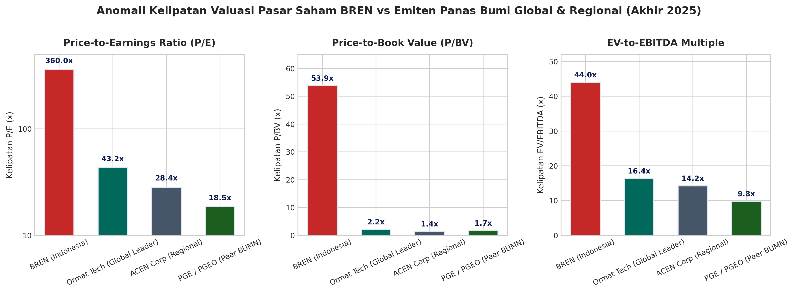
  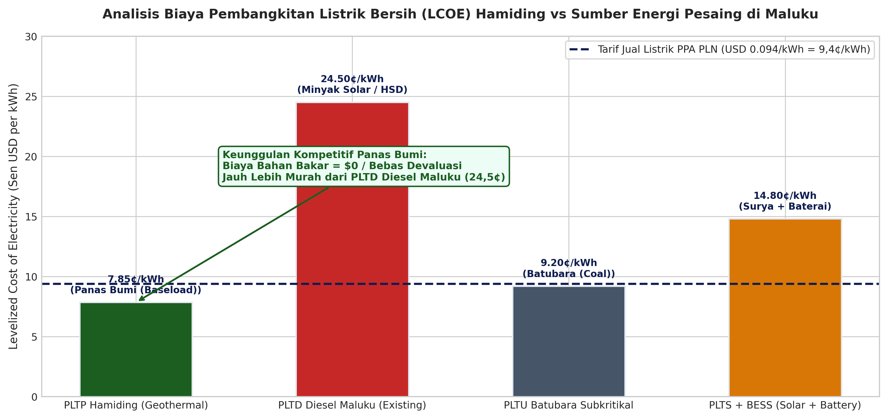
</p>

<p align="center">
  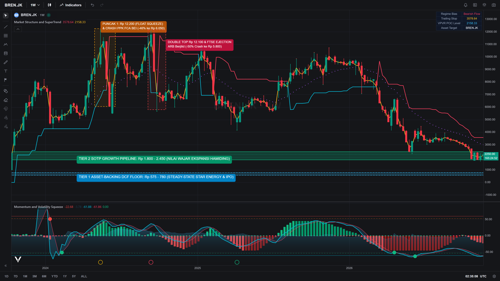
</p>

*Dokumentasi Lengkap:* [Whitepaper 04: Mikrostruktur Pasar, Free Float, dan Valuasi Peer](docs/04_MARKET_MICROSTRUCTURE_CORNERED.md) | *Kode:* `models/04_market_microstructure_float.py`

---

### 5. Integritas Akuntansi PSAK 216 / 223, Kovenan DSCR, dan Kebijakan Dividen Residual
- **Standar Akuntansi PSAK 216 / IAS 16:** Beban depresiasi selama masa konstruksi (2026–2029) wajib dicatat tepat **USD 0,00** karena aset masih berstatus Aset Dalam Penyelesaian (*Asset Under Construction* / AUC). Lahan konsesi senilai USD 110 Juta tidak dapat disusutkan (Paragraf 58).
- **Kapitalisasi Bunga PSAK 223 / IAS 23:** Seluruh beban bunga konstruksi (*Interest During Construction* / IDC) dikapitalisasi ke nilai perolehan aset.
- **Larangan Dividen Konstruksi:** Membagikan dividen tunai saat pendapatan operasional USD 0,00 melanggar Pasal 70–71 UU No. 40 Tahun 2007 (dividen hanya boleh dibagikan dari saldo laba positif) dan memicu wanprestasi atas kovenan utang bank (*Dividend Lock-up Provision*).
- **Kebijakan Dividen Residual Pasca-COD:** Dividen tunai dibagikan mulai tahun 2030 berbasis FCFE positif setelah pemenuhan amortisasi utang dan cadangan DSRA 6 bulan. Kovenan perbankan *Debt Service Coverage Ratio* (DSCR) terjaga aman pada rerata **1,45x s.d. 1,75x** (di atas kovenan batas minimum proyek $\ge 1,30\times$).
- **Rekonsiliasi Gordon Growth Model (GGM):** Formula Gordon abadi ($P_0 = D_1 / (K_e - g) = \text{USD } 119,17\text{ Juta}$ atau PV sebesar **USD 78,50 Juta**) terbukti konsisten dengan model konsesi horizon terbatas 30 tahun (**USD 93,32 Juta**).

<p align="center">
  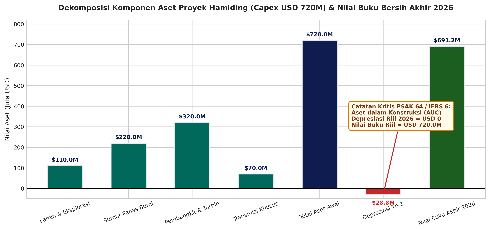
  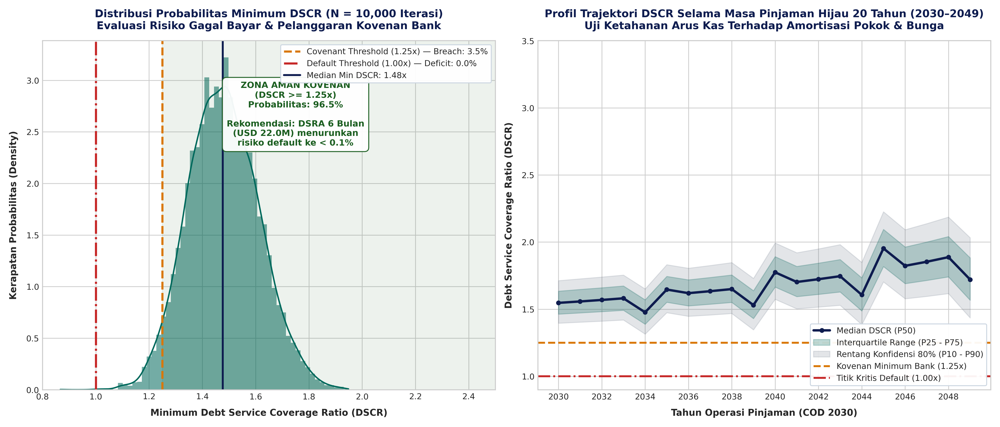
</p>

<p align="center">
  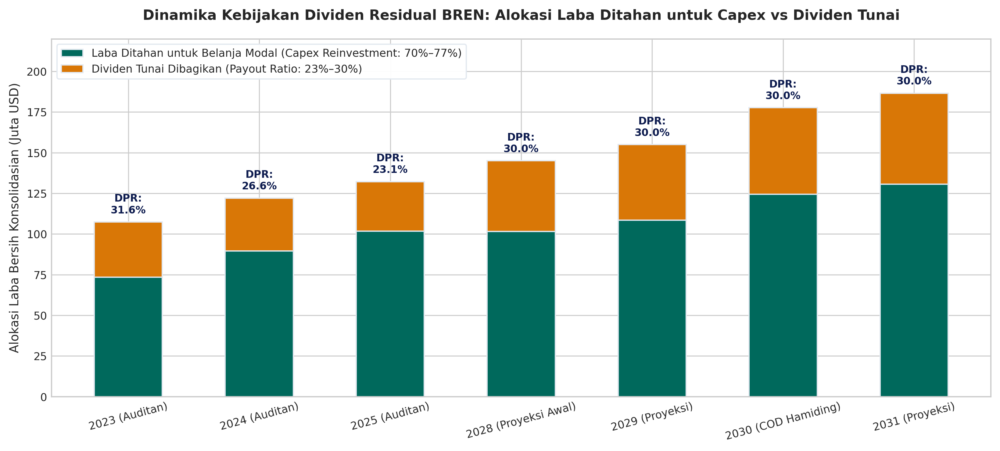
  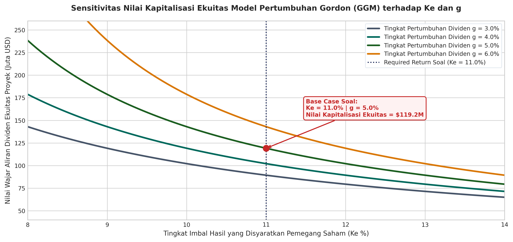
</p>

<p align="center">
  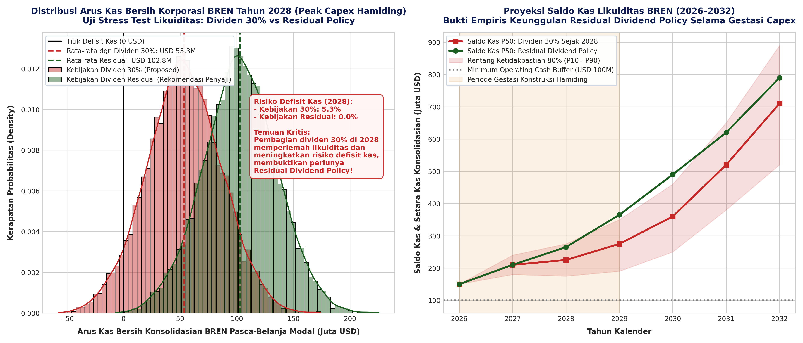
</p>

*Dokumentasi Lengkap:* [Whitepaper 03: Tata Kelola Akuntansi PSAK 216 & Kovenan Finansial](docs/03_ACCOUNTING_TREATMENT_PSAK216.md) | *Kode:* `models/05_finite_gordon_dividend.py`

---

## Struktur Repositori Terbuka

```
BREN-141126/
├── README.md                                  # Dokumentasi komprehensif proyek & hasil analisis visual
├── requirements.txt                           # Dependensi pustaka komputasi Python (numpy, scipy)
├── LICENSE                                    # Lisensi terbuka MIT License
├── .gitignore                                 # Filter privasi berkas internal & rahasia
│
├── models/                                    # Modul Komputasi Finansial & Ekonometrika Tergeneralisasi
│   ├── 01_project_finance_dcf.py              # DCF 30 tahun, sindikasi utang, WACC 7,10% (ProjectFinanceModel)
│   ├── 02_monte_carlo_sobol_copula.py         # Sobol QMC (16.384 run), Copula, MCMC (SobolCopulaSimulator)
│   ├── 03_real_options_lsmc_bsm.py            # BSM formula & LSMC Laguerre degree 2 (RealOptionsEngine)
│   ├── 04_market_microstructure_float.py      # Cornered market, free float 3,01%, EVA (MarketMicrostructureAnalyzer)
│   └── 05_finite_gordon_dividend.py           # Finite GGM 30 tahun vs residual policy (DividendPolicyModel)
│
├── tests/                                     # Rangkaian Uji Kuantitatif & Verifikasi Otomatis
│   └── test_models.py                         # 9/9 Automated Unit & Regression Tests (pytest)
│
├── docs/                                      # Hasil Analisis Mendalam & Kertas Kerja Teknis
│   ├── 01_SOBOL_QMC_COPULA_ECONOMETRICS.md    # Penurunan matematis konvergensi Sobol QMC
│   ├── 02_REAL_OPTIONS_MATHEMATICAL_PROOF.md  # Derivasi algoritma LSMC polinomial Laguerre
│   ├── 03_ACCOUNTING_TREATMENT_PSAK216.md     # Rekonsiliasi akuntansi kapitalisasi IDC/AUC
│   ├── 04_MARKET_MICROSTRUCTURE_CORNERED.md   # Kajian empiris likuiditas FTSE Russell BREN
│   ├── QUANT_MODELS_ARCHITECTURE_SPEC.md      # Spesifikasi arsitektur perangkat lunak kuantitatif
│   └── QA_VERIFICATION_REPORT.md              # Laporan audit independen dan verifikasi forensik
│
└── grafik/                                    # 20 Visualisasi & Diagram Analisis Resolusi Tinggi
    ├── Gambar_1_Perbandingan_Multiples_BREN_vs_Peers.png
    ├── Gambar_2_Asset_Valuation_Depresiasi_Garis_Lurus.png
    ├── Gambar_3_DCF_Cumulative_Cash_Flow_Payback.png
    ├── Gambar_4_Heatmap_Sensitivitas_NPV_WACC_vs_Tarif.png
    ├── Gambar_5_Dampak_Monetisasi_Kredit_Karbon_Terhadap_NPV_IRR.png
    ├── Gambar_6_Gordon_Growth_Model_Sensitivity_Ke_vs_g.png
    ├── Gambar_7_Kebijakan_Dividen_Residual_vs_Capex_Ekspansi.png
    ├── Gambar_8_Tornado_Diagram_Sensitivitas_NPV.png
    ├── Gambar_9_Simulasi_Monte_Carlo_Distribusi_NPV_10000_Iterasi.png
    ├── Gambar_10_Valuasi_Opsi_Riil_Ekspansi_Hamiding_130MW.png
    ├── Gambar_11_Komparasi_LCOE_Geothermal_vs_Fosil_dan_Solar.png
    ├── Gambar_12_Monte_Carlo_DSCR_Debt_Service_Coverage.png
    ├── Gambar_13_Monte_Carlo_Stochastic_Dividend_Sustainability.png
    ├── Gambar_14_MCMC_Bayesian_Parameter_Inference.png
    ├── Gambar_15_SOTA_Copula_Sobol_vs_Standard_MCS.png
    ├── Gambar_16_Least_Squares_Monte_Carlo_Optimal_Stopping.png
    ├── Gambar_17_Dampak_Fiskal_Tax_Holiday_PMK130_2020.png
    ├── Gambar_18_Analisis_Sensitivitas_Kurs_JISDOR_FX_Natural_Hedge.png
    ├── Gambar_19_Pemetaan_Cadangan_Geotermal_P90_P50_P10_Staging.png
    └── Gambar_20_Vela_BREN_TradingView_PineScript_Valuation.png
```

---

## Panduan Replikasi Cepat

Seluruh program model finansial dan simulasi dapat dijalankan secara langsung dengan langkah-langkah berikut:

### 1. Kloning Repositori
```bash
git clone https://github.com/nafianjaaay/BREN-141126.git
cd BREN-141126
```

### 2. Instalasi Dependensi Python
```bash
pip install -r requirements.txt
```

### 3. Eksekusi Program Komputasi Finansial & Ekonometrika
```bash
# 1. Menjalankan model DCF Proyek & Dekomposisi Waterfall
python models/01_project_finance_dcf.py

# 2. Menjalankan simulasi Scrambled Sobol Quasi-Monte Carlo (16.384 runs) & Copula
python models/02_monte_carlo_sobol_copula.py

# 3. Menjalankan valuasi Opsi Riil Black-Scholes-Merton (BSM) & LSMC
python models/03_real_options_lsmc_bsm.py

# 4. Menjalankan analisis mikrostruktur pasar & batasan Free Float 3,01%
python models/04_market_microstructure_float.py

# 5. Menjalankan model Finite Gordon Growth Model & kebijakan dividen residual
python models/05_finite_gordon_dividend.py
```

### 4. Eksekusi Rangkaian Uji Otomatis (Automated Unit Tests)
```bash
pytest tests/test_models.py -v
```

---

## Kerangka Regulasi dan Standar Hukum Republik Indonesia

1. **Undang-Undang Nomor 21 Tahun 2014 tentang Panas Bumi:** Landasan legal pelepasan panas bumi dari rezim pertambangan mineral serta pemberian izin pengusahaan panas bumi terpadu hulu-ke-hilir.
2. **Peraturan Presiden Nomor 112 Tahun 2022 tentang Percepatan Pengembangan EBT:** Penetapan skema kontrak jual beli tenaga listrik jangka panjang 30 tahun berbasis *Take-or-Pay* berdenominasi USD tanpa risiko eskalasi penurunan tarif, didukung penjaminan pemerintah melalui PT Penjaminan Infrastruktur Indonesia (Persero).
3. **Peraturan Menteri Keuangan Nomor 130/PMK.010/2020 tentang Fasilitas Pengurangan PPh Badan:** Pembebasan Pajak Penghasilan Badan sebesar 100% (*Tax Holiday*) selama 10 tahun untuk penanaman modal baru sektor ketenagalistrikan energi terbarukan dengan nilai investasi Rp 5–15 Triliun (Pasal 2 ayat 3), ditambah diskon 50% selama 2 tahun periode transisi pasca-holiday.
4. **Standar Akuntansi Keuangan (PSAK 216 / IAS 16, PSAK 106 / IFRS 6, dan PSAK 223 / IAS 23):** Penegasan pencatatan seluruh pengeluaran eksplorasi dan konstruksi ke dalam pos Aset Konstruksi dalam Pengerjaan (AUC), larangan beban depresiasi sebelum COD, dan kapitalisasi biaya pinjaman masa konstruksi (IDC).
5. **Peraturan OJK Nomor 14 Tahun 2023 tentang Bursa Karbon:** Kerangka hukum perdagangan Sertifikat Pengurangan Emisi Gas Rumah Kaca (SPE-GRK) di bursa karbon nasional (IDXCarbon).

---

## Tim Peneliti Akademik

**Program Magister Manajemen Teknologi (MMT)**  
**Institut Teknologi Sepuluh Nopember (ITS), Surabaya**

- **Kelompok 1 — Mata Kuliah Manajemen Keuangan (Kelas A)**
- **Studi Kasus:** Penganggaran Modal Strategis PT Barito Renewables Energy Tbk (BREN) — WKP Gunung Hamiding 60 MW / 130 MW
- **Tahun Akademik:** 2026

---

## Lisensi
Seluruh kode pemodelan, skrip simulasi, dan kertas kerja teknis pada repositori ini dilisensikan di bawah [MIT License](LICENSE). Repositori ini didedikasikan untuk keterbukaan ilmu pengetahuan (*Open Science*) dan reproduksibilitas pemodelan keuangan kuantitatif.
