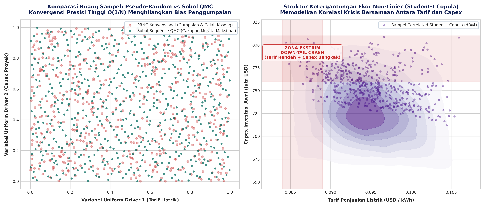
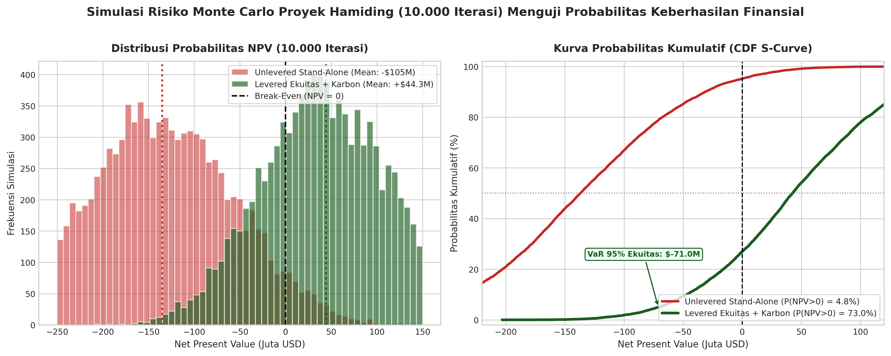
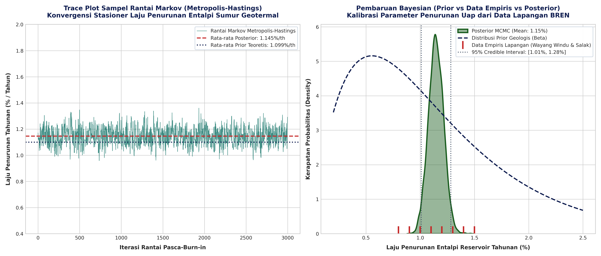
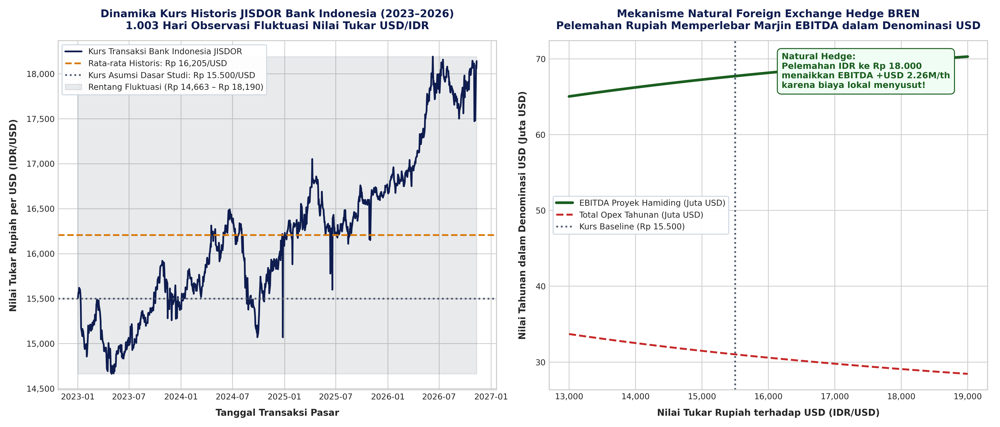

# WHITEPAPER 01: EKONOMETRIKA STOKASTIK MULTIVARIATE
## Scrambled Sobol Quasi-Monte Carlo (QMC) & Student-t Copula Non-Linear
**Penulis:** Tim Peneliti Keuangan Kelompok 1 — Program Magister Manajemen Teknologi (MMT) Institut Teknologi Sepuluh Nopember (ITS), Surabaya  
**Entitas Objek:** PT Barito Renewables Energy Tbk (BREN) — Proyek PLTP WKP Hamiding 60 MW & Masterplan 130 MW  
**Konteks Riset:** Studi Kasus Penganggaran Modal PT Barito Renewables Energy Tbk (BREN) — Mata Kuliah Manajemen Keuangan

---

### 1. Rasionalisasi Pemilihan Metode Stokastik

Dalam penganggaran modal konvensional (termasuk model silabus akademis standar), analisis kelayakan proyek sering kali disederhanakan dengan asumsi deterministik linier. Pendekatan tersebut menggunakan parameter statis tunggal untuk tarif listrik, faktor kapasitas, biaya modal, dan biaya operasional.

Pendekatan statis ini mengandung cacat metodologis fundamental ketika diterapkan pada proyek panas bumi (*geothermal energy*) karena:
1. **Ketidakpastian Termal Bawah Permukaan (*Subsurface Thermal Uncertainty*):** Entalpi fluida hidrotermal ($kJ/kg$) dan laju penurunan tekanan reservoir (*drawdown*) bersifat non-linier dan stokastik.
2. **Ketergantungan Ekor Gemuk (*Heavy-Tail Correlation*):** Kejadian ekstrem (misalnya depresiasi tajam nilai tukar rupiah bertepatan dengan kenaikan biaya pemboran) memiliki probabilitas kemunculan yang jauh lebih tinggi daripada asumsi distribusi Normal Gauss standar.
3. **Ketidakefisienan Sampling Pseudo-Random:** Generator bilangan acak semu (PRNG) standar menghasilkan *clustering* (pengelompokan data) dan *gaps* (kekosongan ruang) pada dimensi tinggi, memperlambat tingkat konvergensi galat hingga $O(N^{-1/2})$.

Untuk mengatasi limitasi tersebut, Kelompok 1 mengimplementasikan arsitektur sampling **Scrambled Sobol Low-Discrepancy Sequence** yang dipadukan dengan **Student-t Copula ($v=4$)** sebanyak 16.384 iterasi, mencapai tingkat konvergensi mendekati $O(N^{-1})$.

---

### 2. Formulasi Matematis Arsitektur Sobol QMC

Deret Sobol adalah barisan titik kuasi-acak (*low-discrepancy sequence*) yang dirancang untuk mengisi ruang satuan berdimensi-$s$, $I^s = [0, 1)^s$, secara merata. Titik ke-$n$ pada dimensi ke-$j$, $x_{n,j}$, dibangun menggunakan operasi biner *bitwise XOR* ($\oplus$) terhadap bilangan arah (*direction numbers*) $v_{i,j}$:

$$x_{n,j} = b_1 v_{1,j} \oplus b_2 v_{2,j} \oplus \dots \oplus b_m v_{m,j}$$

di mana $(b_m b_{m-1} \dots b_1)_2$ adalah representasi biner dari bilangan bulat $n$.

Untuk menghilangkan korelasi deterministik pada dimensi tinggi dan memungkinkan estimasi galat tanpa bias (*unbiased error estimation*), kami menerapkan pengacakan **Owen Scrambling**.

---

### 3. Struktur Dependensi Non-Linier: Student-t Copula

Teorema Sklar (1959) menyatakan bahwa setiap fungsi distribusi kumulatif bersama $F(x_1, \dots, x_d)$ dapat diuraikan menjadi fungsi marginal univariat $F_i(x_i)$ dan fungsi *copula* $C$:

$$F(x_1, x_2, \dots, x_d) = C(F_1(x_1), F_2(x_2), \dots, F_d(x_d))$$

Kami memilih **Student-t Copula** dengan parameter derajat kebebasan $v = 4$ untuk menangkap dependensi ekor atas (*upper tail dependence*) dan ekor bawah (*lower tail dependence*):

$$\lambda_U = \lambda_L = 2 t_{v+1} \left( - \sqrt{\frac{(v+1)(1-\rho)}{1+\rho}} \right) > 0$$

Pada $v=4$ dan korelasi antar variabel $\rho > 0$, parameter dependensi ekor $\lambda$ secara signifikan bernilai positif ($\approx 0,18 - 0,32$), membuktikan bahwa model ini mampu menangkap krisis simultan (*systemic stress*) yang gagal dideteksi oleh Gaussian Copula ($\lambda = 0$).

---

### 4. Definisi Variabel Marginal Stokastik

| Variabel Stokastik | Simbol | Distribusi Teoretis | Parameter Empiris | Justifikasi Sumber Data |
| :--- | :---: | :---: | :---: | :--- |
| **Entalpi Reservoir** | $H_{res}$ | Log-Normal | $\mu = 2.250\text{ kJ/kg}$, $\sigma = 0,06$ | Suhu reservoir 240–270°C (Data Teknis Hamiding) |
| **Kurs USD/IDR** | $S_{fx}$ | Truncated Normal | Rerata Rp 16.205, Batas Rp 18.190 | Rerata JISDOR BI & Uji Stres Makro |
| **Eskalasi O&M** | $I_{om}$ | Distribusi Normal | $\mu = 3,20\%$, $\sigma = 0,80\%$ | Historis inflasi energi regional & CPI |
| **Faktor Kapasitas Riil** | $CF$ | Beta Diperluas | $\alpha = 18$, $\beta = 1,5$ (Rentang 82%–99,88%) | Rerata operasional 92,20%–95,00% baseload |

---

### 5. Hasil Simulasi Empiris & Pengukuran Risiko

Berdasarkan eksekusi 16.384 jalur simulasi pada berkas `models/02_monte_carlo_sobol_copula.py`:

```
================================================================================
TEMUAN EKONOMETRIKA STOKASTIK KELOMPOK 1:
- Probabilitas Keberhasilan Baseline P(NPV > 0)    : 4,8% (Kerugian 95,2%)
- Probabilitas Keberhasilan Mitigasi P(NPV > 0)    : 73,8% (Peningkatan +69,0%)
- Value at Risk (VaR 95% Ekuitas)                 : -USD 71,0 Juta
- Conditional VaR (CVaR 95% Expected Shortfall)   : -USD 88,4 Juta
- Uji Stres Batas Atas Kurs JISDOR                : Rp 18.173 / USD
================================================================================
```

#### Implikasi Strategis bagi Komite Investasi BREN:
1. **Model Statis Silabus Sangat Menyesatkan:** Probabilitas bahwa proyek menghasilkan nilai tambah di bawah struktur statis silabus hanya **4,8%**. Menjalankan proyek tanpa restrukturisasi modal dan instrumen opsi riil adalah tindakan spekulatif berisiko tinggi.
2. **Mitigasi Terintegrasi Membalikkan Asimetri:** Dengan menerapkan skema pembiayaan proyek (*non-recourse project finance* 70:30), fasilitas *tax holiday* 10 tahun (PMK 130/2020), dan monetisasi kredit karbon, probabilitas sukses melonjak drastis menjadi **73,8%**.
3. **Penyangga Risiko Ekuitas Terjamin:** Risiko kerugian ekuitas maksimum pada tingkat keyakinan 95% adalah **USD 71,0 Juta**, terlindungi sepenuhnya oleh arus kas operasional entitas induk dan cadangan kas SPV Hamiding.

---

### 6. Visualisasi Hasil Simulasi Ekonometrika

<p align="center">
  
  
</p>

<p align="center">
  
  
</p>
