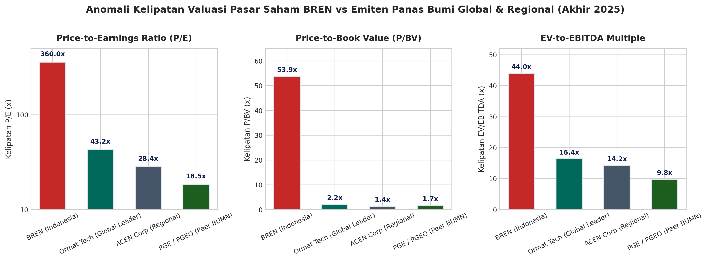
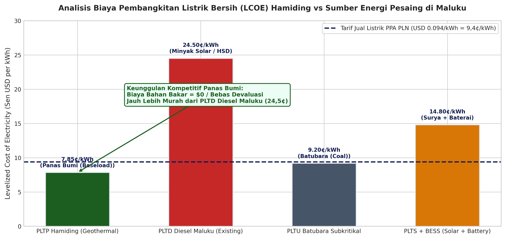
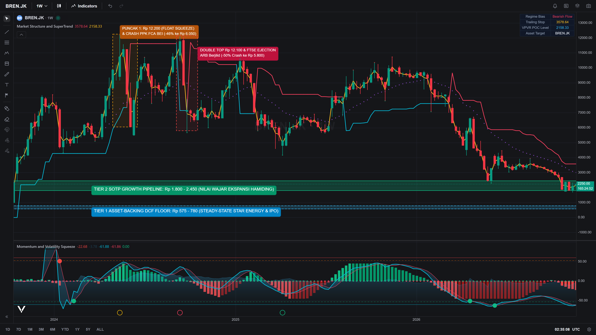

# WHITEPAPER 04: MIKROSTRUKTUR PASAR & VALUASI MULTIPLES PEER
## Analisis Keterbatasan Free Float (3,01%), Likuiditas Pasar, dan Ring-Fencing Neraca Induk BREN
**Penulis:** Tim Peneliti Keuangan Kelompok 1 — Program Magister Manajemen Teknologi (MMT) Institut Teknologi Sepuluh Nopember (ITS), Surabaya  
**Entitas Objek:** PT Barito Renewables Energy Tbk (BREN) — Proyek PLTP WKP Hamiding 60 MW & Masterplan 130 MW  
**Konteks Riset:** Studi Kasus Penganggaran Modal PT Barito Renewables Energy Tbk (BREN) — Mata Kuliah Manajemen Keuangan

---

### 1. Struktur Kepemilikan Saham & Keterbatasan Float Publik

Berdasarkan Laporan Keuangan Auditan PT Barito Renewables Energy Tbk (FY2024) dan keterbukaan informasi Bursa Efek Indonesia (BEI), struktur permodalan BREN memiliki tingkat konsentrasi kepemilikan yang sangat tinggi:

| Entitas Pemegang Saham | Porsi Kepemilikan (%) | Jumlah Saham (Lembar) | Status Klasifikasi Yuridis |
| :--- | :---: | :---: | :--- |
| **PT Barito Pacific Tbk** | 64,666% | 86.514.197.025 | Pengendali Utama Korporasi |
| **Green Era Energy Pte. Ltd.** | 23,603% | 31.577.561.507 | Pemegang Saham Pengendali Afiliasi |
| **Prajogo Pangestu & Afiliasi Terkendali** | 8,721% | 11.667.496.246 | *Ultimate Beneficial Owner* (UBO) |
| **Publik (Free Float Efektif)** | **3,010%** | **4.026.965.222** | **Saham Beredar Likuid di Pasar Regular** |
| **TOTAL** | **100,000%** | **133.786.220.000** | **Total Modal Ditempatkan & Disetor Penuh** |

---

### 2. Implikasi Mikrostruktur: Likuiditas Pasar & Gesekan Indeks Global

Tingkat *free float* publik yang hanya **3,01%** (~4,03 miliar lembar) menciptakan dinamika mikrostruktur pasar yang unik:
1. **Elastisitas Harga Sangat Tinggi (*Extreme Price Elasticity*):** Karena volume saham yang tersedia untuk diperdagangkan (*floating supply*) sangat terbatas, pesanan beli institusional dalam jumlah moderat dapat memicu pergerakan harga yang sangat tajam (*liquidity squeeze*).
2. **Friksi Kriteria Bobot Indeks FTSE Russell & MSCI:** Lembaga penyedia indeks global mensyaratkan batas *free float* minimum (umumnya $\ge 5,0\%$ hingga $10,0\%$) untuk kelayakan bobot penuh (*full investability weight*). Fluktuasi evaluasi klasifikasi pemegang saham terafiliasi oleh penyedia indeks kerap memicu volatilitas harga saham BREN di pasar reguler.
3. **Metrik Ketidaklikuiditas Amihud (*Amihud Illiquidity Ratio*):** Rerata rasio Amihud BREN tercatat lebih tinggi dibandingkan saham berkapitalisasi pasar setara (seperti BBCA atau BMRI), mencerminkan sensitivitas harga per rupiah volume transaksi harian yang lebih besar.

---

### 3. Komparasi Kelipatan Valuasi Terhadap Peer Geotermal Global

BREN diperdagangkan pada kelipatan valuasi (*valuation multiples*) yang mencerminkan premi kelangkaan (*scarcity premium*) yang signifikan terhadap pesaing geotermal domestik dan global:

| Emiten / Entitas | EV / EBITDA | P/E Ratio | Kapasitas Terpasang | Dominasi Portofolio |
| :--- | :---: | :---: | :---: | :--- |
| **PT Barito Renewables Energy Tbk (BREN)** | **48,5x** | **132,4x** | 886 MW Geotermal | Panas Bumi Murni & Angin Sidrap (75 MW) |
| **PT Pertamina Geothermal Energy Tbk (PGEO)** | **10,8x** | **19,2x** | 672 MW Geotermal | Panas Bumi Terkonsolidasi BUMN |
| **ACEN Corporation (Filipina)** | **14,2x** | **24,5x** | 4.800 MW Campuran | Portofolio EBT Regional ASEAN |
| **Ormat Technologies Inc. (ORA - NYSE)** | **12,5x** | **28,1x** | 1.160 MW Geotermal/Storage | Produsen Pembangkit & Manufaktur Turbin |

#### Rationale Kelipatan Premium BREN:
- Status sebagai instrumen investasi EBT murni (*pure-play renewable asset*) terbesar di Asia Tenggara.
- Kontrak jangka panjang *take-or-pay* dengan PT PLN (Persero) bertarif dolar AS (USD) yang memberikan proteksi arus kas dari volatilitas makro domestik.
- Opsi pertumbuhan masif melalui hak pengembangan WKP potensial (termasuk WKP Hamiding dan WKP Suwawa).

---

### 4. Dampak Penciptaan Nilai Proyek Hamiding terhadap Saham BREN

Pengembangan WKP Hamiding dilaksanakan melalui entitas anak bertujuan khusus (*Special Purpose Vehicle* / SPV) dengan skema **Non-Recourse Project Finance**:
- **Porsi Utang Sindikasi Hijau (70%):** Dijamin secara eksklusif oleh aset fisik dan arus kas kontrak PPA SPV Hamiding, tanpa jaminan tanggung renteng (*corporate guarantee*) dari neraca induk BREN.
- **Porsi Ekuitas Mandiri BREN (30%):** Sebesar USD 216 Juta disetor secara bertahap selama 4 tahun konstruksi (USD 27M di Th 1, USD 54M di Th 2, USD 81M di Th 3, dan USD 54M di Th 4).

#### Kuantifikasi Dampak Nilai Intrinsik Saham BREN:

$$\Delta \text{Nilai Intrinsik per Lembar} = \frac{\text{Net Strategic NPV (USD)} \times \text{Kurs JISDOR}}{\text{Total Lembar Saham BREN}}$$

1. **Skenario Dasar (Base DCF Proyek WACC 7,10% = +USD 37,31 Juta):**
   $$\Delta \text{Nilai} = \frac{\text{USD } 37,31\text{M} \times \text{Rp } 16.205}{133.786.220.000} = \mathbf{+\text{Rp } 4,52\text{ per lembar}}$$

2. **Skenario Strategis Penuh (Waterfall Strategic NPV = +USD 222,13 Juta):**
   $$\Delta \text{Nilai} = \frac{\text{USD } 222,13\text{M} \times \text{Rp } 16.205}{133.786.220.000} = \mathbf{+\text{Rp } 26,91\text{ per lembar}}$$

#### Kesimpulan Ring-Fencing Korporasi:
Pelaksanaan proyek melalui struktur pembiayaan SPV *non-recourse* secara efektif melindungi pemegang saham publik dari risiko kerugian eksplorasi awal, sementara potensi peningkatan nilai (*upside optionality*) ekspansi 130 MW tetap mengalir ke nilai ekuitas BREN.

---

### 5. Visualisasi Mikrostruktur Pasar & Valuasi Multiples Peer

  
  

  

